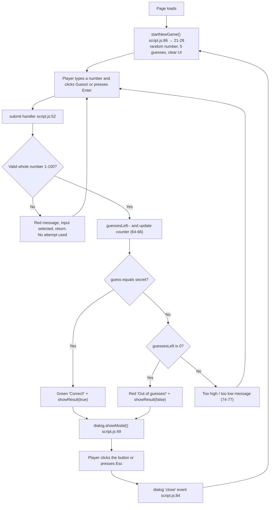

# Project Map: Bluey Number Guessing Game

All paths are relative to the `docs/` folder. Line numbers were checked against the current files.

## 1. Overview

A single-player **Number Guessing Game** with a Bluey-inspired look: sky-blue background, a cream card, orange buttons, a grassy strip and paw prints. The game picks a secret whole number from 1 to 100. The player has 5 guesses. After each guess the game says "too high" or "too low". It always shows how many guesses remain. When the game ends, a pop-up announces a win or loss. Closing the pop-up starts a new game automatically. Rules come from `../CLAUDE.md`. The intended layout is in `../resources/number guessing wireframe.png`.

**How to run**
- Simplest: open `../index.html` in a browser.
- Or serve it locally: run `python3 -m http.server 8000` in the project folder, then visit `http://localhost:8000`.
- There is no build step and no framework. The only external resource is the Fredoka font from Google Fonts (`../index.html` lines 8-10). The game works without it, using the fallback font.

## 2. File map

| File | Single responsibility |
|---|---|
| [`../index.html`](../index.html) (56 lines) | Structure: every piece of text, the input, the button, the counter, the pop-up. It holds no game logic. |
| [`../style.css`](../style.css) (234 lines) | Appearance: colours, fonts, layout, paw prints, grass, pop-up styling and sizing on small screens. |
| [`../script.js`](../script.js) (86 lines) | Behaviour: secret number, validation, feedback, guess counting, win/lose pop-up, restart. |
| [`../CLAUDE.md`](../CLAUDE.md) | Game rules and project guidelines. |
| `../resources/number guessing wireframe.png` | Design wireframe with four screens: wrong guess, wrong guess plus lose pop-up, right guess, right guess plus win pop-up. |

**Wireframe versus built game.** The layout matches. The wording and decoration differ:
- The wireframe shows "your guess was incorrect/correct". The game shows "N is too high/low" (`../script.js` lines 75 and 77).
- The wireframe's lose pop-up says "I am sorry you did not guess in time". The game says "Oh, biscuits! You ran out of guesses." (line 45).
- The wireframe's win pop-up says "Congrats! You Guessed Correctly!". The game says "Hooray! You guessed it!" (line 40).
- The button labels "Play Again" and "Try Again" match the wireframe.
- The paw prints, grass and Bluey colours are not in the wireframe.

## 3. Feature roadmap (where each feature lives)

| Feature | HTML (`../index.html`) | CSS (`../style.css`) | JS (`../script.js`) |
|---|---|---|---|
| **New game / random number** | n/a | n/a | `startNewGame()` lines 21-28. The random pick is line 22. It also resets guesses (23), the counter display (24), the input (25), the feedback (26) and focus (27). The settings are the constants on lines 2-4. It is first called at line 86 on page load. |
| **Submitting a guess** | `<form id="guess-form">` lines 27-33, with the submit button "Guess!" on line 31 | `button` 99-125; `.guess-row` 75-79 | `form.addEventListener("submit", ...)` lines 52-81. `event.preventDefault()` on line 53 stops the page reloading. The guess is read on line 55. |
| **Input validation** | `<input type="number" id="guess-input" min="1" max="100" step="1" required>` line 30. The form has `novalidate` (line 27), so the browser's own popups are off and JS handles it. | `.feedback.wrong` 135-137 (red message) | Lines 57-62. Blank, non-integer, below 1 or above 100 all show "Please enter a whole number from 1 to 100." (line 59). The input text is selected (60) and the function returns early, so an invalid guess **does not use up an attempt**. |
| **Too high / too low feedback** | `
` line 35 | `.feedback` 128-133; `.feedback.wrong` 135-137; `.feedback.right` 139-141 | `showFeedback(message, type)` lines 31-34. It is called at line 75 ("too high"), line 77 ("too low"), line 69 ("Correct!", green) and line 72 ("Out of guesses!"). The branch order is lines 68-78. |
| **Remaining guesses counter** | `
` lines 37-40, with the number in `
5
` line 39 | `.remaining p` 143-146; `.remaining .guesses-left` 148-152 (large number) | Decremented on line 64 and displayed on lines 65 and 24. The display element is declared on line 14. |
| **Win/lose pop-up** | `<dialog id="result-dialog">` lines 44-50, with `#result-title` (46), `#result-message` (47) and `#result-button` (48) | `dialog` 200-210; `dialog::backdrop` 212-214; `dialog.win` 216-219 (green); `dialog.lose` 221-224 (red); `dialog h2` 226-229; `dialog p` 231-234 | `showResult(won)` lines 37-50. The win text is on lines 39-42 and the lose text on lines 44-47. Both messages reveal the number (lines 41 and 46). `dialog.showModal()` on line 49 opens it. The calls are on line 70 (win) and line 73 (lose). |
| **Auto-restart on pop-up close** | `<form method="dialog">` line 45, with the submit button on line 48. Submitting it closes the dialog. | n/a | `dialog.addEventListener("close", startNewGame)` line 84. The `close` event fires for the button and the Esc key (see the comment on line 83). |
| **Bluey theme** | Decorative paws (aria-hidden) lines 15-19; grass strip line 52; Fredoka font lines 8-10; Bluey-style wording in the pop-up | Palette variables `:root` lines 2-13; background gradient (28); `.grass` 32-42; `.paws`/`.paw` 155-170; toe beans `.paw::before/::after` 173-193; second paw rotated (195-197); `.card` 45-55 | Theme wording only, e.g. "Oh, biscuits!" (line 45) |
| **Responsive layout** | `<meta name="viewport" ...>` line 5 | There are **no media queries**. It is fluid instead. `.card` is `width: 90%; max-width: 480px` (47-48). The headings use `clamp()` (59, 65). Dialog is `width: 90%; max-width: 400px` (201-202). Buttons are at least 48px tall (100). The body is a centred flex layout (22-25). The input is `width: 100%; max-width: 200px` (83-84). | n/a |

Not in the code, so not documented as features: score tracking, difficulty levels, a guess history, sound, and multiplayer.

## 4. How the pieces connect

### Shared names

**Element IDs.** These are linked by name between HTML and JS. JS looks them up with `getElementById` on lines 11-18.

| ID | HTML line | JS variable (line) | Used for |
|---|---|---|---|
| `guess-form` | 27 | `form` (11) | Listening for submit |
| `guess-input` | 30 | `input` (12) | Reading and clearing the guess |
| `feedback` | 35 | `feedback` (13) | Message text and colour class |
| `guesses-left` | 39 | `guessesLeftDisplay` (14) | Showing the remaining count |
| `result-dialog` | 44 | `dialog` (15) | Opening the pop-up, `close` event, win/lose class |
| `result-title` | 46 | `resultTitle` (16) | Pop-up heading |
| `result-message` | 47 | `resultMessage` (17) | Pop-up body |
| `result-button` | 48 | `resultButton` (18) | Button label |

**Classes shared between HTML, CSS and JS**
- `.feedback` is set in the HTML (line 35) and styled in the CSS (128). JS rewrites the whole class string to `"feedback wrong"`, `"feedback right"` or plain `"feedback "` (line 33). That drives the colours in CSS lines 135-141.
- `.win` and `.lose` are set only by JS (lines 39 and 44) on the `<dialog>`. They are styled in CSS lines 216-224.
- `.card`, `.instructions`, `.guess-row`, `.remaining`, `.guesses-left`, `.paws`, `.paw` and `.grass` are HTML-to-CSS only.

JS never touches the CSS file directly. It only changes text and class names. CSS then decides what those classes look like.

### Event flow

Notes on the order:
- The win check (line 68) runs before the out-of-guesses check (line 71), so a correct guess on the final attempt counts as a win.
- On a win or loss the feedback line is set first and the pop-up opens straight after. When the pop-up closes, `startNewGame()` clears the feedback, counter and input.

## 5. Plain-language analogies

Think of the game as a **children's TV show set**.

| Part | Analogy | In this game |
|---|---|---|
| `index.html` | The **skeleton** or the **set builders' floor plan**. It decides what is on stage and in what order. | The title, the box where you type, the "Guess!" button, the "Remaining Guesses" number and the hidden pop-up. |
| `style.css` | The **clothes and make-up**. It changes how things look, not what they do. | Bluey blue and orange colours, the cream card, the grass at the bottom, the paw prints, red or green message text. |
| `script.js` | The **brain**. It remembers things, makes decisions and gives instructions. | It remembers the secret number and the guesses left. It decides "too high", "too low" or "correct", and when to show the pop-up. |
| The secret number | A **toy hidden in a box** that the player has to find. `startNewGame()` hides it somewhere new each round. | `secretNumber`, a random number from 1 to 100 |
| Guess counter | **5 tokens**. Each real guess spends one. | `guessesLeft`. Typing something silly, like "banana" or 500, does not spend a token. |
| Feedback message | A **friendly referee** saying "warmer or colder", but with "higher or lower". | The `feedback` text (red for wrong, green for right) |
| The pop-up | The **end-of-episode card**. It appears over everything, and closing it starts the next episode. | `<dialog>` with a win (green) or lose (red) look |
| Element IDs | **Name tags** on stage props. The brain says "move the prop called `guesses-left`" and the set knows which one. | `id="guesses-left"` and similar |
| Classes | **Costume labels**. The brain pins a "wrong" or "right" label on the referee, and the wardrobe department knows to dress that in red or green. | `.wrong`, `.right`, `.win`, `.lose` |

## 6. How to make common changes

| Change | Where |
|---|---|
| **Number of guesses** | Change `MAX_GUESSES` at `../script.js` line 2. Also update the visible text "You have 5 guesses total." at `../index.html` line 24 and the starting display `5` at `../index.html` line 39. The latter is replaced on load, but keep it consistent. |
| **Number range** | Change `MIN_NUMBER` and `MAX_NUMBER` at `../script.js` lines 3-4. Also update `min="1" max="100"` on `../index.html` line 30, the instruction text "between 1 and 100" on line 23, and the error message at `../script.js` line 59. **Caution:** the random formula on line 22 (`Math.floor(Math.random() * MAX_NUMBER) + MIN_NUMBER`) is only correct while `MIN_NUMBER` is 1. For any other minimum, change it to `Math.floor(Math.random() * (MAX_NUMBER - MIN_NUMBER + 1)) + MIN_NUMBER`. |
| **Colours** | Edit the variables in `:root`, `../style.css` lines 2-13. Most colours flow from there. The exceptions are the pop-up backgrounds `#e3f6d8` (line 217) and `#fde3e0` (line 222), the page gradient end `#cbe8ff` (line 28), white input (89), white button text (105), and the translucent backdrop (213). |
| **Pop-up messages** | Win: title line 40, message line 41, button label line 42. Lose: title line 45, message line 46, button label line 47. All in `../script.js`. |
| **Feedback messages** | Too high: `../script.js` line 75. Too low: line 77. Correct: line 69. Out of guesses: line 72. Invalid input: line 59. |
| **Page title and heading** | Browser tab title: `../index.html` line 6. On-page heading: line 21. |
| **Font** | The Google Fonts link is `../index.html` line 10. The `font-family` is `../style.css` line 26. |
| **Card width or text sizes** | `.card` `max-width` at `../style.css` line 48; the `clamp()` sizes at lines 59 and 65. |
| **Remove or move the decorations** | Paws: delete `../index.html` lines 15-19 (and optionally CSS 155-197). Grass: delete `../index.html` line 52 (and optionally CSS 32-42). |

Per `../CLAUDE.md`, explain any major change to how the game works before making it, and do not add unrequested features.
